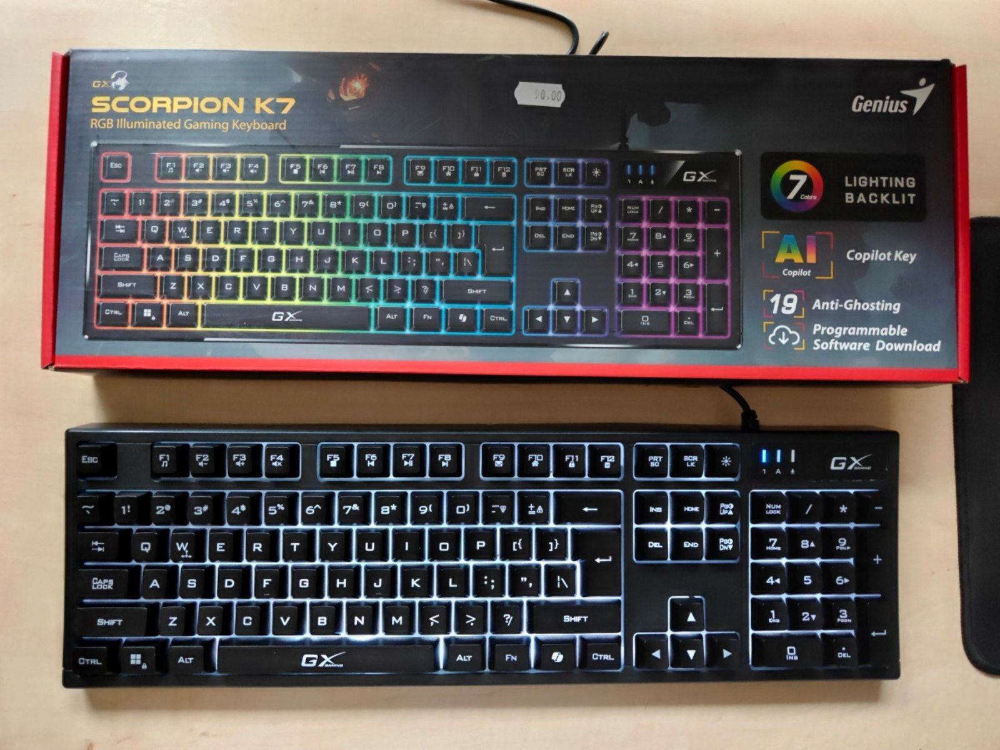
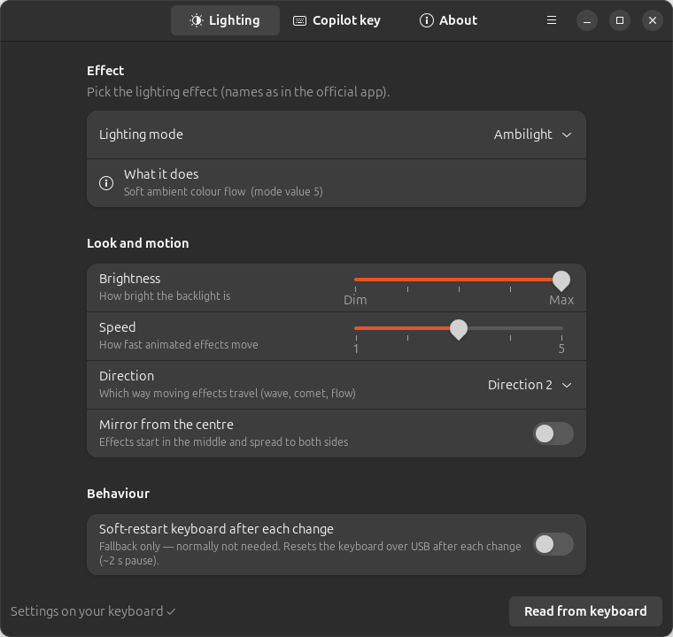
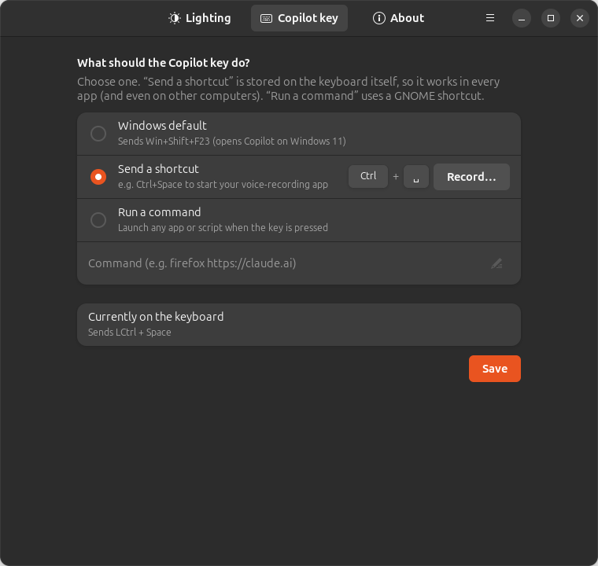

# Scorpion K7 for Linux

An open-source Linux alternative to the official Windows app for the
**Genius Scorpion K7** RGB gaming keyboard (USB `0458:6013`).

A budget keyboard (**90 lei, about €16**) whose configuration software only
runs on Windows. Now it can be configured on Linux too: the protocol was
reverse-engineered from the official app and rebuilt as a native GNOME app.



| Lighting | Copilot key |
|---|---|
|  |  |

- **Lighting** — mode, brightness, speed, direction and mirroring. Changes apply
  live as you move the controls, no "Apply" button.
- **Copilot key** — keep the Windows default, make it **send any shortcut**
  (e.g. `Ctrl+Space` to start a voice-recording app), or **run a command**.
  Shortcuts are stored on the keyboard itself, so they work in every app and on
  other computers too.
- **Top-bar icon** — the app keeps running in the top bar when you close the
  window; click the keyboard icon to open it again. Enable **☰ → Start at
  login** to have it there after every login (it starts hidden).
- Settings are saved in the keyboard's onboard memory.
- No kernel driver needed: it talks to the keyboard through the standard Linux
  `hidraw` interface.

> Not affiliated with Genius / KYE Systems. "Genius" and "Scorpion" are their
> trademarks.

## Install (Ubuntu / Debian)

1. Download `scorpion-k7_<version>_all.deb` from the
   [latest release](https://github.com/nirodg/scorpion-keyboard/releases/latest).
2. Install it (**requires sudo**: it installs the dependencies and a udev rule):

   ```sh
   sudo apt install ./scorpion-k7_*_all.deb
   ```

3. **Unplug and replug the keyboard once** so the new udev rule applies.
4. Open **Scorpion K7** from the app grid, or run `scorpion-k7`.
5. Optional: **☰ → Start at login** to keep it in the top bar.

The package installs:

| What | Where |
|---|---|
| App | `/usr/share/scorpion-k7/`, launchers `scorpion-k7` (GUI) and `scorpion-k7-cli` |
| Desktop entry | `/usr/share/applications/io.github.scorpion_k7.desktop` |
| udev rule | `/usr/lib/udev/rules.d/70-scorpion-k7.rules` |
| Dependencies | `python3-gi`, `gir1.2-gtk-4.0`, `gir1.2-adw-1`, `libglib2.0-bin` |

Uninstall with `sudo apt remove scorpion-k7`.

### Why the udev rule (and sudo)?

By default only root may send configuration commands to USB devices. The rule
gives the **logged-in desktop user** (systemd `uaccess`) access to *this
keyboard only*, so the app runs without root:

```
KERNEL=="hidraw*", ATTRS{idVendor}=="0458", ATTRS{idProduct}=="6013", TAG+="uaccess"
SUBSYSTEM=="usb", ENV{DEVTYPE}=="usb_device", ATTR{idVendor}=="0458", ATTR{idProduct}=="6013", TAG+="uaccess"
```

## Run from source (any distro)

```sh
# Debian/Ubuntu dependencies; on Fedora: python3-gobject gtk4 libadwaita
sudo apt install python3-gi gir1.2-gtk-4.0 gir1.2-adw-1
sudo cp 70-scorpion-k7.rules /etc/udev/rules.d/
sudo udevadm control --reload-rules && sudo udevadm trigger
# unplug/replug the keyboard, then:
python3 scorpion_k7_gui.py             # add --background to start in the top bar only
```

## Command line

```sh
scorpion-k7-cli find                        # show the keyboard's config interface
scorpion-k7-cli led                         # show the current lighting record
scorpion-k7-cli set-led --mode 2 --yes      # change lighting (see --help)
scorpion-k7-cli dump 0x0 0x1000 -o backup.bin   # back up the 4 KB settings memory
scorpion-k7-cli release                     # hand the keyboard back to normal typing
```

## Troubleshooting

- **No icon in the top bar** — GNOME needs the *AppIndicator* extension
  (enabled by default on Ubuntu; elsewhere install
  `gnome-shell-extension-appindicator`). KDE Plasma works out of the box.
  Without it the app still works: closing the window quits it.
- **Keyboard stops typing** — open the ☰ menu → *Recover keyboard*. The first
  click sends the "apply" command, a second click within 15 s resets the
  keyboard over USB. Unplug/replug always works as a last resort, and your
  settings are kept.
- **"Keyboard not found"** — check `lsusb | grep 0458:6013` and that the udev
  rule is installed, then replug.
- **Copilot key "Run a command" does nothing** — this option uses a GNOME
  custom shortcut. On other desktops, bind `Shift+Super+XF86TouchpadOff` (Linux
  sees the Copilot key's F23 as `XF86TouchpadOff`) to your command, or use
  *Send a shortcut* instead, which works everywhere.

## How it works

The protocol was reverse-engineered from the official Windows app: every
setting is an 8-byte HID feature report (ID 7) to the keyboard's vendor
interface (usage page `0xFF01`). Settings live in a 4 KB onboard memory as
small records (lighting, key map, Fn table, macro slots). Any memory access
pauses typing until an "apply" command is sent, so the app always ends with
apply + release. See [PROTOCOL-NOTES.md](PROTOCOL-NOTES.md) for the full
memory map and evidence.

## Build the .deb

```sh
packaging/build-deb.sh      # -> dist/scorpion-k7_<version>_all.deb
```

The version comes from `VERSION` in `scorpion_k7_gui.py`. Bump it, build, and
attach the `.deb` to a new GitHub release.

## Thanks

- **Brage Dorin** ([@nirodg](https://github.com/nirodg)): author, testing and
  direction.
- **[REA](https://github.com/morluto/rea)**: the reverse-engineering toolkit
  used to decode the keyboard protocol from the official app.

## License

[MIT](LICENSE). Free to use, modify and share, including in your own projects.
